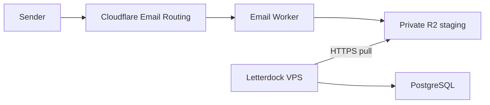

# Letterdock

An Apache-2.0, self-hosted incoming email workspace. Cloudflare Email Routing accepts mail,
a Worker stages each message in private R2, and Letterdock reads it over HTTPS.
Catch-all addresses appear after their first message. The app has no billing tier.

**Collect incoming email across your domains in one inbox.**


| Inbox | Integrations | Operations |
| --- | --- | --- |
| Automatic catch-all addresses, search, labels, archive and trash | Read-only API, attachments and signed webhooks with replay | Private staging, health view, retry and PostgreSQL backup |



The code and local verification are available now. Live delivery and recovery checks
are tracked in [release status](docs/progress.md).

## Start locally

Copy `.env.example` to `.env`. Set an admin password of at least 16 characters and
generate unique session and PostgreSQL secrets with `openssl rand -hex 32`.
Use a URL-safe PostgreSQL password because Compose puts it in a connection URL.

```sh
docker compose up -d --build
```

The dashboard listens on loopback. For remote access, run a TLS reverse proxy on the VPS
with the app as its upstream, and set `PUBLIC_URL` to that HTTPS origin before starting.
The VPS needs outbound HTTPS to R2 and inbound HTTPS for dashboard/API access.
No SMTP port is required on the VPS.

## Receive mail

1. Create a private Cloudflare R2 bucket. Set its name in `cloudflare/wrangler.toml`.
2. Deploy the Worker with Wrangler from `cloudflare/`. Use Cloudflare Email Routing
   to set the catch-all action to that Worker for each apex domain. Review existing MX
   records before changing them.
3. Set `R2_BUCKET`, `R2_ENDPOINT` and the two S3-compatible credential fields in `.env`.
   The R2 token must be scoped to the staging bucket and permit list, read and delete.
4. In the dashboard, register each domain, publish its verification TXT and verify DNS.
   Send externally to a new address and check that the inbox appears.

Cloudflare controls routing and message size limits. R2 is a staging buffer. Leave objects
in place until app ingestion succeeds. Monitor Worker logs for staging failures and R2
usage for accumulation. The importer deletes an object after a committed ingest or an
explicit rejection recorded in its ingest log.

## Backup and upgrade

```sh
docker compose exec -T db pg_dump -U letterdock -Fc letterdock > letterdock.dump
```

Restore the dump into an empty database with the same owner before starting the app.
Keep an encrypted copy of deployment secrets alongside the backup in protected storage.
Before upgrading, take a fresh backup and keep the previous image. Build and start the new
version via Compose, then check Health, send to a fresh address and verify the webhook.
