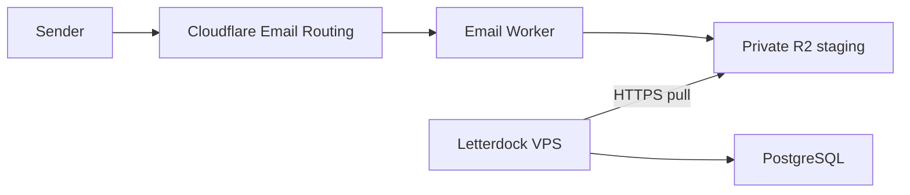

# Letterdock

An Apache-2.0, self-hosted incoming email workspace. Cloudflare Email Routing accepts mail,
a Worker stages each message in private R2, and Letterdock reads it over HTTPS.
Catch-all addresses appear after their first message. The app has no billing tier.

**Collect incoming email across your domains in one inbox.**


| Inbox | Integrations | Operations |
| --- | --- | --- |
| Automatic catch-all addresses, search, labels, archive and trash | Read-only API, attachments and signed webhooks with replay | Private staging, health view, retry and PostgreSQL backup |



The code and local verification are available now. Live delivery and recovery checks
are tracked in [release status](docs/progress.md).

## Start locally

Copy `.env.example` to `.env`. Set an admin password of at least 16 characters and
generate unique session and PostgreSQL secrets with `openssl rand -hex 32`.
Use a URL-safe PostgreSQL password because Compose puts it in a connection URL.

```sh
docker compose up -d --build
```

The dashboard listens on loopback. For remote access, run a TLS reverse proxy on the VPS
with the app as its upstream, and set `PUBLIC_URL` to that HTTPS origin before starting.
The VPS needs outbound HTTPS to R2 and inbound HTTPS for dashboard/API access.
No SMTP port is required on the VPS.

## Receive mail

1. Create a private Cloudflare R2 bucket. Set its name in `cloudflare/wrangler.toml`.
2. Deploy the Worker with Wrangler from `cloudflare/`. Use Cloudflare Email Routing
   to set the catch-all action to that Worker for each apex domain. Review existing MX
   records before changing them.
3. Set `R2_BUCKET`, `R2_ENDPOINT` and the two S3-compatible credential fields in `.env`.
   The R2 token must be scoped to the staging bucket and permit list, read and delete.
4. In the dashboard, register each domain, publish its verification TXT and verify DNS.
   Send externally to a new address and check that the inbox appears.

Cloudflare controls routing and message size limits. R2 is a staging buffer. Leave objects
in place until app ingestion succeeds. Monitor Worker logs for staging failures and R2
usage for accumulation. The importer deletes an object after a committed ingest or an
explicit rejection recorded in its ingest log.

## Backup and upgrade

```sh
docker compose exec -T db pg_dump -U letterdock -Fc letterdock > letterdock.dump
```

Restore the dump into an empty database with the same owner before starting the app.
Keep an encrypted copy of deployment secrets alongside the backup in protected storage.
Before upgrading, take a fresh backup and keep the previous image. Build and start the new
version via Compose, then check Health, send to a fresh address and verify the webhook.

## Production checklist

- Point the dashboard hostname to the VPS. Configure HTTPS on your reverse proxy.
  See [the sample Caddyfile](deploy/Caddyfile.example). Caddy's default certificate
  setup requires public access to HTTP or HTTPS for domain validation.
- Set `PUBLIC_URL` to the exact public HTTPS origin. The origin must match requests
  from the browser for authenticated changes.
- Keep PostgreSQL and the application port private. The sample Compose file binds
  the app to loopback and has no published database port.
- Use separate test domains for inbound validation. Confirm DNS ownership, catch-all
  routing, an external test message, and inbox visibility before switching any live MX.

## Automatic domain setup

For an existing Cloudflare Email Worker and R2 staging bucket, set
`CLOUDFLARE_EMAIL_WORKER` to the deployed Worker name, and provide a
zone-scoped `CLOUDFLARE_API_TOKEN` on the server. Grant Zone Read, DNS Edit,
Zone Settings Edit, and Email Routing Rules Edit on the zones to onboard.
Keep the token in the server environment.

Adding a domain checks whether Letterdock can access its Cloudflare zone. Review
the preflight, then select **Set up Cloudflare** to create verification TXT,
enable Email Routing, and route catch-all to the installed Worker. Letterdock
stops if it sees unrelated MX records or a catch-all owned by another setup.
Letterdock checks DNS while the Domains page is open. Manual verification is also available. The dashboard can stay on localhost.

On localhost through SSH, open **Domains → Cloudflare connection → Connect Cloudflare**
to save a zone-scoped token from the dashboard. The server validates the token
with Cloudflare and encrypts it in PostgreSQL using `SESSION_SECRET`. Keep that
secret with the backup. An environment token takes precedence. Disconnecting
the dashboard token removes Letterdock's saved credential.

## Inbound safety limits and API keys

The Worker rejects messages over 20 MiB. Letterdock imports up to 512 MiB of
raw mail per domain per rolling 24 hours by default. Mail over this allowance
is discarded at import and recorded as `domain_quota` in Health. Because
Cloudflare accepts mail before Letterdock imports it, that quota does not
generate a sender bounce.

The importer defers new mail in staging when the estimated database usage
would exceed 10 GiB or free storage would fall below 1 GiB. Set
`INBOUND_DOMAIN_DAILY_BYTES`, `INBOUND_DATABASE_BYTES`, and
`INBOUND_MIN_FREE_BYTES` in `.env` to tune these thresholds. If Postgres is on
a separate storage mount, set `DISK_PATH` to a path on that filesystem
accessible to the app. Managed Cloudflare staging expires unimported objects
after seven days. For a manually managed bucket, configure a lifecycle rule
for the `mail/` prefix.

API keys are limited to one verified domain when created. Older unscoped keys
are disabled. Create replacement keys in Integrations and update their
consumers. Trash and expired mail are excluded from the API and attachment
downloads. Webhook signing secrets are encrypted on startup using a key
derived from `SESSION_SECRET`; preserve that secret across upgrades.

For installations with an existing managed Cloudflare Worker, run the
following after upgrading to refresh the Worker and staging lifecycle.
Use the same Compose files used for deployment.

```sh
docker compose exec -T app node --import tsx --input-type=module -e '
  import { refreshManagedIngress } from "./src/cloudflare-ingress.ts";
  import { db } from "./src/db.ts";
  try { await refreshManagedIngress(); } finally { await db.end(); }
'
```
